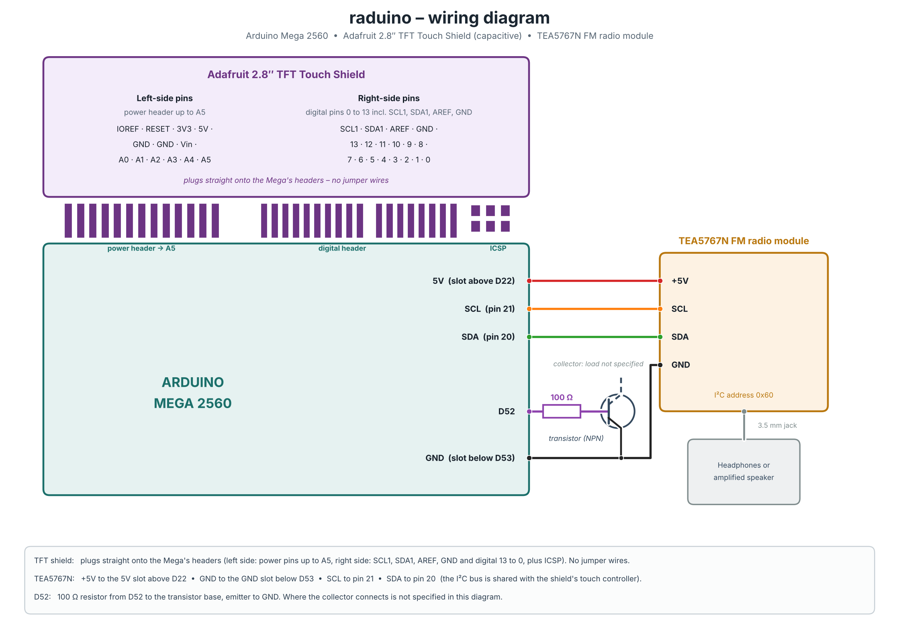

# raduino

A touchscreen FM radio built with an **Arduino Mega 2560**, a **TEA5767N** FM receiver module and an **Adafruit 2.8" TFT Touch Shield** with capacitive touch (ILI9341 display + FT6206 touch controller).

Tap `<<` and `>>` to step through your preset stations, tap **PAUSE** to mute, and watch the frequency, stereo/mono state and signal strength on the screen and in the Serial Monitor.



## Contents

- [Features](#features)
- [What you need](#what-you-need)
- [Wiring](#wiring)
- [Software setup](#software-setup)
- [Upload the sketch](#upload-the-sketch)
- [Using the radio](#using-the-radio)
- [Changing the preset stations](#changing-the-preset-stations)
- [Troubleshooting](#troubleshooting)
- [Known issues](#known-issues)
- [Project structure](#project-structure)
- [License](#license)
- [Credits](#credits)

## Features

- 7 preset FM stations, editable in one line of code
- Touchscreen buttons: previous station `<<`, next station `>>`, and PLAY/PAUSE (mute and unmute)
- Current station frequency shown on the display
- Serial Monitor output (115200 baud) with frequency, STEREO/MONO and signal level (0-15) after every station change
- Presets wrap around: `>>` on the last station goes to the first, `<<` on the first goes to the last

## What you need

| Qty | Part | Notes |
|----:|------|-------|
| 1 | Arduino Mega 2560 | Plus a USB-B cable for power and programming |
| 1 | Adafruit 2.8" TFT Touch Shield for Arduino with **Capacitive** Touch, product **ADA1947** | ILI9341 display and FT6206 touch controller. Plugs straight onto the Mega. See the note below |
| 1 | TEA5767N FM radio module | The common blue module with a 3.5 mm audio jack |
| 1 | Transistor | Connected to digital pin 52, see [Wiring](#wiring) |
| 1 | 100 ohm resistor | In series between digital pin 52 and the transistor base |
| 1 | Headphones or an amplified speaker | The TEA5767N outputs headphone-level audio. The headphone cable usually doubles as the FM antenna |
| a few | Jumper wires | For the TEA5767N and the transistor |

> **Capacitive vs resistive touch.**
> Adafruit sells this shield in two versions. This project needs the **capacitive** one (ADA1947), which reads touches through an FT6206 chip on the I2C bus and works with the `Adafruit_FT6206` library used here.
> The **resistive** version (ADA1651) uses a different touch controller and needs modifications to work on a Mega, so it will not work with this sketch as it is.

The microSD slot on the shield is not used.

## Wiring

The TFT shield plugs straight onto the Mega's headers, so it needs no wires. The TEA5767N is connected with four jumper wires.


An editable vector version is in [`docs/wiring.svg`](docs/wiring.svg).

### Adafruit 2.8" TFT Touch Shield (plugs in, no wires)

| Shield side | Plugs into on the Mega 2560 |
|-------------|-----------------------------|
| Left-side pins | The power header up to the analog pin A5 (IOREF, RESET, 3V3, 5V, GND, GND, Vin, A0 to A5) |
| Right-side pins | The digital header from pin 0 up to pin 13, including SCL1, SDA1, AREF and GND |
| ICSP header | The Mega's ICSP header, which carries the hardware SPI signals |

Pins used by the sketch:

| Signal | Mega 2560 pin | Notes |
|--------|---------------|-------|
| TFT chip select | 10 | `TFT_CS` in the sketch |
| TFT data/command | 9 | `TFT_DC` in the sketch |
| SPI (display data) | 50 MISO, 51 MOSI, 52 SCK | Reached through the ICSP header |
| Touch controller | SDA and SCL | Through the SDA/SCL header pins next to AREF |

### TEA5767N to Arduino Mega 2560

| TEA5767N pin | Mega 2560 connection |
|--------------|----------------------|
| GND | The GND slot below digital pin 53 |
| +5V (VCC) | The 5V slot above digital pin 22 |
| SCL | SCL, communication pin 21 |
| SDA | SDA, communication pin 20 |
| 3.5 mm jack | Headphones or an amplified speaker |

### Transistor on digital pin 52

| Connection | Goes to |
|------------|---------|
| Digital pin 52 | 100 ohm resistor, then the transistor base |
| Transistor emitter | GND |
| Transistor collector | Whatever you want to switch (not specified in this project) |

The sketch does not use digital pin 52 itself.

### Wiring notes

- **I2C is shared.** The shield's touch controller (address `0x38`) and the TEA5767N (address `0x60`) sit on the same two wires, SDA and SCL. The SDA/SCL header pins next to AREF are the same bus as pins 20 and 21 on the Mega.
- **Power the TEA5767N from 5V.** The documentation of one TEA5767 Arduino library states that the module does not work on 3.3V.
- **Pin 52 is also the hardware SPI clock (SCK).** The shield's display uses the SPI bus through the ICSP header, so anything else connected to digital pin 52 shares a line with the display clock.
- According to Adafruit's guide, the capacitive shield can simply be placed onto an Arduino with no wiring or soldering: [Adafruit 2.8" TFT Touch Shield v2](https://learn.adafruit.com/adafruit-2-8-tft-touch-shield-v2).

## Software setup

1. Install the [Arduino IDE](https://www.arduino.cc/en/software) (1.8.x or 2.x).
2. Install these libraries from **Sketch > Include Library > Manage Libraries**:
   - **Adafruit GFX Library**
   - **Adafruit ILI9341**
   - **Adafruit FT6206 Library**

   The IDE may offer to install their dependencies (for example Adafruit BusIO). Say yes.
3. Install the **TEA5767N** library. It is not in the Library Manager, so install it from a ZIP:
   1. Open <https://github.com/mroger/TEA5767> and choose **Code > Download ZIP**.
   2. In the Arduino IDE choose **Sketch > Include Library > Add .ZIP Library...** and pick the downloaded file.

   `Wire` and `SPI` come with the IDE.

## Upload the sketch

1. Clone or download this repository:
   ```
   git clone https://github.com/agent-pjb/raduino.git
   ```
2. Open `raduino/raduino.ino` in the Arduino IDE.
3. Select **Tools > Board > Arduino AVR Boards > Arduino Mega or Mega 2560**, and **Tools > Processor > ATmega2560 (Mega 2560)**.
4. Select the right **Port**, then click **Upload**.
5. Optional: open the Serial Monitor at **115200 baud** to see status messages.

## Using the radio

| Control | What it does |
|---------|--------------|
| `>>` | Tune to the next preset station (wraps from the last to the first) |
| `<<` | Tune to the previous preset station (wraps from the first to the last) |
| PAUSE | Mute the audio |
| PLAY | Unmute the audio |

After each station change the Serial Monitor prints a line like this:

```
Tuning to next station
Current freq: 107.50MHz Signal: STEREO 12/15
```

The radio starts on the first preset in the list.

## Changing the preset stations

Edit the `stations` array near the top of `raduino/raduino.ino`:

```cpp
double stations[] = {88.3, 92.3, 93.9, 97.1, 99.5, 105.9, 107.5}; // Your station presets
```

Use frequencies in MHz, for example `98.7`. You can add or remove entries freely: the index of the last preset (`maxstation`) is worked out automatically from the array size.

Other settings you may want to change are `TFT_CS` and `TFT_DC` (the TFT control pins, 10 and 9 by default, which match the shield).

## Troubleshooting

**The screen stays white or blank**
- Press the shield fully down onto the Mega's headers and check that no pins are bent.
- Check that you have the capacitive shield (ADA1947).
- Check that the four libraries are installed.

**The sketch stops with "Couldn't start FT6206 touchscreen controller"**
- You probably have the resistive shield, or the shield is not making contact with the SDA/SCL header pins.
- Re-seat the shield and make sure nothing else is pulling SDA or SCL low.

**Touches land in the wrong place or buttons do not respond**
- The sketch flips both touch axes to match screen rotation 0. If you change `tft.setRotation(...)`, the mapping in `gettouch()` has to change too.
- Tap the middle of each button. A tap is only counted when the touch point moves more than a few pixels from the previous one.

**No sound, or only static**
- Plug headphones or an amplified speaker into the TEA5767N's 3.5 mm jack.
- Press PAUSE then PLAY to make sure the audio is not muted.
- Power the module from 5V, not 3.3V.
- Try stretching the headphone cable out, or add a wire on the antenna pad if your module has one. Low signal numbers in the Serial Monitor mean poor reception.

**Compile errors**
- Make sure all four libraries are installed.
- The sketch calls `tft.begin(tft.read16())`. If your version of the Adafruit ILI9341 library does not have `read16()`, change that line in `guistart()` to `tft.begin();`.

## Known issues

- The PLAY/PAUSE button can get out of step with the real mute state. At start-up PLAY is shown even though the audio is already on, and after you change station the PAUSE button is drawn again whether or not the audio is muted.
- A few unused definitions (`MUTEPIN`, `STATIONPIN`, the `TS_*` calibration values) are left over from earlier versions and do nothing.

## Project structure

```
raduino/
├── raduino/
│   └── raduino.ino           The Arduino sketch
├── docs/
│   ├── wiring.png            Wiring diagram
│   └── wiring.svg            Wiring diagram (vector)
├── .gitattributes
├── .gitignore
├── CHANGELOG.md
├── LICENSE
└── README.md
```

## License

This project is released under the [MIT License](LICENSE).

## Credits

- [Adafruit GFX](https://github.com/adafruit/Adafruit-GFX-Library), [Adafruit ILI9341](https://github.com/adafruit/Adafruit_ILI9341) and [Adafruit FT6206](https://github.com/adafruit/Adafruit_FT6206_Library) libraries by Adafruit Industries
- [TEA5767N library](https://github.com/mroger/TEA5767) by mroger
